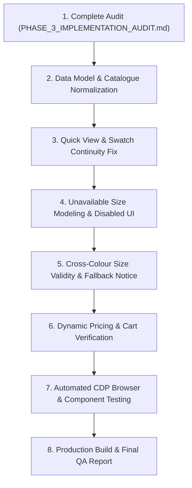

# MORFE — Phase 3 Implementation Audit
**Product Variants & Dynamic Pricing**

- **Date:** November 21, 2026
- **Base Baseline:** Phase 2 Accepted Baseline (Commit `a433b63` / `bba374d`)
- **Current Branch:** `feature/phase-3-product-variants-dynamic-pricing`
- **Target Reference:** [Sheet Society Storefront](https://sheetsociety.com/en)
- **Status:** Mandatory Preliminary Audit Completed

---

## 1. Executive Summary

This audit assesses the MORFE bedding e-commerce storefront for **Phase 3: Product Variants & Dynamic Pricing**. In accordance with phase governance, no application code has been altered prior to this audit.

The existing implementation possesses robust foundational capabilities established in Phase 2, including:
- A rich 167-product catalogue across 18 bedding categories.
- Strict 3-tier colourway image isolation (dedicated gallery → single verified image → `ImageOff` placeholder).
- Baseline variant pricing in `product.variantPrices`.
- Cart item keying by `${product.id}-${color.name}-${size}`.

However, several critical inconsistencies and functional gaps have been identified that prevent a seamless, reference-grade variant-selection experience:
1. **Quick View Colourway Loss:** Clicking "Quick View" on `ProductCard` discards the customer's hovered or selected colourway, reverting to `product.colors[0]`.
2. **Shopify Data Leak (`"Default Title"`):** 11 single-size products display raw `"Default Title"` buttons in the modal size picker instead of domain-appropriate terms or single-size indicators.
3. **Absence of Unavailable Size Distinctions:** All sizes are currently rendered as clickable, available buttons, despite Sheet Society live data containing 29 unavailable size variants across key collections.
4. **Lack of Cross-Colourway Size Validity Reconciliation:** Switching colourways does not verify if the currently selected size exists or is in stock for the newly selected colour, risking invalid selections.
5. **No Visual State Feedback on Forced Size Reset:** When an unavailable size is reset upon colourway switch, no feedback is given to explain why the size changed.

---

## 2. Existing Implementation Architecture

### 2.1 Data Models (`src/types/index.ts`)
```typescript
export interface Product {
  id: string;
  name: string;
  category: BeddingCategory;
  material: BeddingMaterial;
  price: number;
  salePrice?: number;
  variantPrices?: Record<string, number>;
  minPrice?: number;
  maxPrice?: number;
  colors: ColorVariant[];
  sizes: BedSize[];
  dimensions: Record<string, string>;
  inStock?: boolean;
  // ...
}

export interface CartItem {
  id: string; // unique item cart key: `${productId}-${color.name}-${size}`
  product: Product;
  selectedColor: ColorVariant;
  selectedSize: BedSize;
  quantity: number;
  unitPrice: number;
}
```

### 2.2 Product Catalogue Analysis (`src/data/mockData.ts`)
A deep scan of the 167 catalogue products reveals:
- **Products with `variantPrices`:** 167 (100% coverage).
- **Products with multiple sizes:** 127 products (Quilt Covers, Fitted Sheets, Flat Sheets, Protectors, Cushions).
- **Products with single size:** 40 products (Pillowcases, Towels, Throws, Sleepwear, Baby).
- **Products with raw `"Default Title"`:** 11 products (e.g. `corduroy-european-pillowcase-russet`, `linen-bedding-cloud`).

### 2.3 Component Inventory & Product Interaction Flow
| Component | Current Variant Role | Identified Gap / Inconsistency |
| :--- | :--- | :--- |
| `src/components/ProductCard.tsx` | Renders 5 swatches + counter, updates image preview on hover/click, shows `From formatPKR(minPrice)`. | `onQuickView(product)` does not pass `activeColor`. Customer loses selected swatch upon opening modal. |
| `src/components/ProductDetailModal.tsx` | Displays colourway swatches, size grid, quantity stepper, dynamic price calculation (`currentUnitPrice`), add to bag. | Renders `"Default Title"` buttons for 11 products; lacks unavailable size indicators/disablement; does not validate size availability on colourway switch. |
| `src/components/CartDrawer.tsx` | Lists cart items with colourway thumbnail, size, quantity controls, dynamic subtotal. | Correctly stores and calculates `unitPrice * quantity`, but UI could highlight size-specific unit prices more clearly. |
| `src/components/BestsellersGrid.tsx` | Renders product grid with tabs. | Passes `onQuickView={onQuickView}` without accepting `initialColor`. |
| `src/components/BestsellersRail.tsx` | Horizontal carousel of featured products. | Passes `onQuickView={onQuickView}` without accepting `initialColor`. |
| `src/components/CatalogView.tsx` | Main shop catalogue grid. | Passes `onQuickView={onQuickView}` without accepting `initialColor`. |
| `src/components/SearchModal.tsx` | Live search dialog with product matches. | Passes `product` to `onSelectProduct` without initial colourway. |
| `src/components/ShopTheLook.tsx` | Interactive bedroom hotspot looks. | Directly calls `onQuickView(product)` without specifying look-specific colourway. |
| `src/App.tsx` | State hub for `cartItems`, `selectedProduct`, `selectedProductColor`. | `handleSelectProduct` already supports `(product, initialColor)`, but `onQuickView` props across children do not supply it. |

---

## 3. Reference-Site Observations (Sheet Society)

Direct inspection of `sheetsociety.com/en` reveals the following benchmark interaction patterns:

1. **Colourway Selection & Synchronized Quick View:**
   - Swatching a colour immediately updates the gallery, URL/slug, and active colour name.
   - When launching Quick View from a collection card, the modal opens directly into the swatch that the customer had selected or was actively previewing on the card.
2. **Size Grid & Price Display:**
   - Bedding categories with multiple sizes display clean rectangular pills (`Double`, `Queen`, `King`, `Super King`).
   - Under each size pill or dynamically in the price header, the exact price for that size is clearly indicated.
   - Quilt covers and sheet sets scale progressively in price with bed size.
3. **Availability & Stock Distinctions:**
   - Sold-out or unavailable sizes are visibly distinguished (muted background, diagonal strike-through, or "Sold Out" tag).
   - Unavailable sizes cannot be selected or added to bag.
4. **Single-Size Products:**
   - For items with no size options (e.g. European pillowcase 65x65cm, body pillow 48x150cm, throw blankets), Sheet Society either omits the size selection grid or shows a static dimension pill (e.g., "Standard Sizing" or "65 x 65cm").
   - Never exposes internal CMS or Shopify labels like `"Default Title"`.
5. **Selection State Preservation on Variant Changes:**
   - Switching colourways preserves the selected size (e.g. `King`) if `King` is available in the new colour.
   - If `King` is out of stock in the newly selected colour, the selector automatically reverts to the primary available size (e.g. `Queen`) and displays a non-intrusive notification: *"King is currently unavailable in [Colour]. Switched to Queen."*
   - Switching colours preserves selected quantity.
   - Switching sizes updates price immediately without resetting selected colour.
6. **Cart Line Separation:**
   - Different sizes or colours of the same base product appear as separate cart line items.
   - Each item reflects its specific colourway image, selected size, and exact unit price.

---

## 4. Missing & Inconsistent Functionality

1. **Quick View Colourway Continuity Defect:**
   - In `ProductCard.tsx`, clicking the image stage triggers `onSelectProduct(product, activeColor)`, which correctly opens the modal with the chosen colour.
   - However, clicking either the mobile floating eye button (`sm:hidden`) or desktop hover button (`sm:flex`) invokes `onQuickView(product)` without `activeColor`.
   - **Resolution:** Align `onQuickView` signature to `(product: Product, initialColor?: ColorVariant) => void` across all parent and child components.
2. **Shopify `"Default Title"` Leak:**
   - 11 products currently list `sizes: ['Default Title']`.
   - **Resolution:** Normalize `'Default Title'` to clean domain terms based on product category:
     - European pillowcases: `'European (65x65cm)'`
     - Bedding bundles: `'Standard Set'` / `'Queen'`
     - Throws/Accessories: `'One Size'`
3. **Unavailable Sizes Representation:**
   - Live Sheet Society source data in `raw_sheetsociety_products.json` contains 29 unavailable size variants (e.g. `Darcy Corduroy - Olive Solid Quilt Cover` is unavailable in `Double` and `King`).
   - `mockData.ts` and `types/index.ts` currently lack a structured field to represent unavailable sizes per colourway.
   - **Resolution:** Add `unavailableSizes?: Record<string, BedSize[]>` (or `colorUnavailableSizes`) to `Product`, populated with authentic Sheet Society stock records.
4. **Unavailable Size UI Handling in `ProductDetailModal`:**
   - Currently, all buttons in `product.sizes` can be clicked and added to bag.
   - **Resolution:** Render unavailable sizes with diagonal strike styling, `disabled={isUnavailable}`, and `opacity-40 cursor-not-allowed`. Add an "Out of Stock" badge when selected. Prevent adding to bag.
5. **Cross-Colourway Size Re-validation & Notification:**
   - When the user selects a new colour, verify whether `selectedSize` is available for that colour.
   - If available, preserve it.
   - If unavailable, reset to the first available size and display a polite notification banner (e.g., *"Double is sold out in Olive Solid. Updated to Queen."*).
6. **Quantity Preservation:**
   - Verify that quantity is strictly maintained across colourway and size changes.

---

## 5. Files Requiring Modification

| File | Purpose of Modification |
| :--- | :--- |
| `src/types/index.ts` | Add `colorUnavailableSizes?: Record<string, BedSize[]>` to `Product` interface to support authentic colourway-specific size stock status. |
| `src/data/mockData.ts` | 1. Replace 11 raw `'Default Title'` entries with authentic size strings (`'European (65x65cm)'`, `'Standard Set'`, etc.).<br>2. Populate authentic Sheet Society `colorUnavailableSizes` from `raw_sheetsociety_products.json`. |
| `src/components/ProductCard.tsx` | Update `onQuickView` prop signature to `(product: Product, initialColor?: ColorVariant) => void` and pass `activeColor`. |
| `src/components/BestsellersGrid.tsx` | Forward `(product, initialColor)` in `onQuickView`. |
| `src/components/BestsellersRail.tsx` | Forward `(product, initialColor)` in `onQuickView`. |
| `src/components/CatalogView.tsx` | Forward `(product, initialColor)` in `onQuickView`. |
| `src/components/ShopTheLook.tsx` | Pass look-specific colour to `onQuickView`. |
| `src/components/ProductDetailModal.tsx` | 1. Implement unavailable size state (visual styling, disable click, prevent add to bag).<br>2. Handle single-size/no-size products gracefully.<br>3. Implement cross-colour size validation with automatic fallback and notice toast.<br>4. Ensure quantity preservation.<br>5. Dynamic price recalculation across header, size pills, and Add to Bag CTA. |
| `src/components/CartDrawer.tsx` | Ensure size-specific pricing is clearly visible on each line item. |
| `scripts/validate-catalogue.cjs` | Add assertions ensuring 0 instances of `"Default Title"` exist in catalogue sizes, and that all `colorUnavailableSizes` reference valid sizes. |
| `scripts/test_client_interactions.cjs` | Expand headless Chrome CDP test suite to assert swatch-preserved Quick View, unavailable size blocking, dynamic pricing, cross-colour fallback, and cart line separation. |

---

## 6. Proposed Implementation Sequence



1. **Step 1:** Establish baseline audit (this document).
2. **Step 2:** Update `src/types/index.ts` and `src/data/mockData.ts` to eliminate raw `"Default Title"` and integrate authentic Sheet Society variant availability.
3. **Step 3:** Propagate `initialColor` through `onQuickView` in `ProductCard`, `BestsellersGrid`, `BestsellersRail`, `CatalogView`, and `ShopTheLook`.
4. **Step 4:** Enhance `ProductDetailModal.tsx` to handle available vs unavailable sizes, single-size products, and dynamic pricing.
5. **Step 5:** Implement size preservation logic with automatic fallback and feedback notice upon colourway switch.
6. **Step 6:** Verify cart integration (line-item separation, price calculation, quantity updates).
7. **Step 7:** Extend automated test suites (`validate-catalogue.cjs`, `test_client_interactions.cjs`) and execute tests in headless Chrome.
8. **Step 8:** Run `npm run build` and compile `PHASE_3_FINAL_QA_REPORT.md`.

---

## 7. Potential Regression Risks & Safeguards

| Potential Risk | Impact Area | Mitigation & Safeguard |
| :--- | :--- | :--- |
| **Cross-Colour Image Isolation Breach** | `ProductDetailModal`, `ProductCard` | Strictly retain the approved 3-tier resolver (`gallery` → `image` → `ImageOff`). Never introduce `product.images` fallback. Phase 2 validation scripts will be executed to guarantee zero regressions. |
| **React Hooks Inconsistency** | `ProductDetailModal` | All hooks (`useState`, `useEffect`, `useMemo`, `useRef`) must continue executing unconditionally before any early returns (`if (!isOpen || !product) return null;`). |
| **Cart Price Miscalculation** | `App.tsx`, `CartDrawer.tsx` | Maintain explicit `unitPrice` on `CartItem`. Ensure quantity updates multiply the item's preserved `unitPrice`, and never reset to base `product.price`. |
| **Broken Selectors in Existing Automated Tests** | `test_client_interactions.cjs` | Verify that changes to size button labels or availability attributes do not break existing test query selectors. Add resilient data attributes (e.g. `data-size="Queen"`, `data-available="true"`). |
| **Accidental Overwrite of Distinct Cart Variants** | `CartDrawer.tsx`, `App.tsx` | Ensure cart key remains strictly `${product.id}-${color.name}-${size}` so different sizes of the same colourway exist as separate lines. |

---

## 8. Conclusion

With the completion of this audit, the path forward is clearly defined. The implementation will preserve 100% of Phase 2 achievements while introducing authentic Sheet Society variant selection, unavailable size handling, dynamic pricing, and seamless cross-component state continuity.
