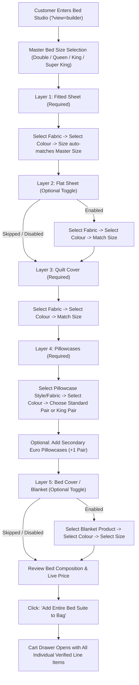
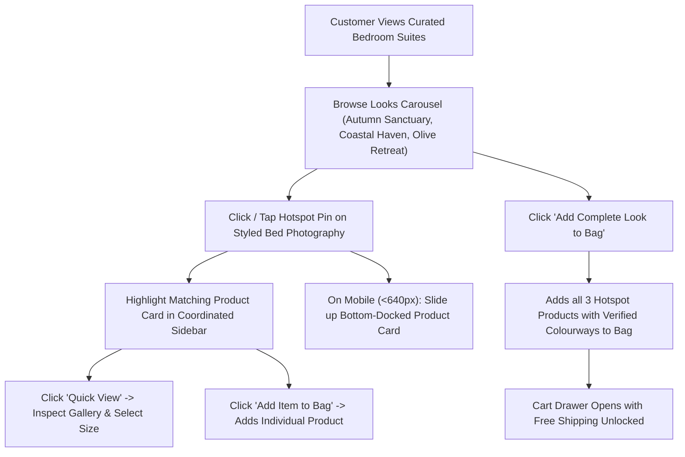

# MORFE — Phase 6.0: Bed Builder & Shop the Look — Architecture Audit & Technical Plan

**Project:** MORFE — The Quiet Atelier  
**Repository:** `haro1047on-ctrl/Bedding-Website`  
**Working Branch:** `feature/phase-6-bed-builder`  
**Accepted Phase 5 Baseline Commit SHA:** `4d6144e061195051d2e6592491bc2320a03d7a61`  
**Date:** 2026-11-23  
**Status:** Audit & Planning Phase (Strictly Read-Only on Production Storefront Code)  

---

## 1. Git Baseline and Branch Verification

### 1.1 Baseline Audit
- **Repository Remote:** `https://github.com/haro1047on-ctrl/Bedding-Website.git`
- **Accepted Phase 5 Branch:** `feature/phase-5-plp-faceted-filtering`
- **Accepted Phase 5 Baseline Commit:** `4d6144e061195051d2e6592491bc2320a03d7a61`
- **Current Active Branch:** `feature/phase-6-bed-builder`
- **Branch Ancestry:** `feature/phase-6-bed-builder` was branched directly from `4d6144e061195051d2e6592491bc2320a03d7a61`.
- **Working Tree Status:** Clean (`nothing to commit, working tree clean`).
- **Discipline Enforced:**
  - Zero modification to `feature/phase-5-plp-faceted-filtering`.
  - Zero force-pushes or history rewrites.
  - No merge to `main`.
  - No production code modified during this audit phase.

---

## 2. Existing Architecture & Relevant File Paths

The MORFE storefront is built on React 18, Vite 5, TypeScript 5, and Tailwind CSS 3. The architecture adheres to a quiet luxury aesthetic inspired by Sheet Society, with strict data integrity and colourway isolation established across Phases 1 through 5.

### Key File Mapping

| Architecture Area | Primary File Paths | Current Responsibility |
|:---|:---|:---|
| **Entry & View Router** | `src/App.tsx` | View routing (`home` vs `catalog`), global cart state (`cartItems`), modal controllers, toast alerts, URL hash and popstate listener |
| **Type Definitions** | `src/types/index.ts` | Authoritative interfaces: `Product`, `ColorVariant`, `BeddingCategory`, `BeddingMaterial`, `BedSize`, `CartItem`, `BedroomLook`, `FilterState`, `FacetCounts` |
| **Catalogue & Ground Truth** | `src/data/mockData.ts`<br>`src/data/products.ts`<br>`src/data/imageManifest.json` | 167 authentic products, 263 colourways, verified image mappings, `BEDROOM_LOOKS` definitions |
| **Filtering & Availability Logic** | `src/utils/filterUtils.ts` | Pure functions: `normalizeText`, `isSizeAvailable`, `productMatchesFilters`, `computeFacetCounts`, `parseUrlFilters`, `serializeUrlFilters` |
| **Cart Drawer & Presentation** | `src/components/CartDrawer.tsx` | Slide-over drawer, free shipping threshold progress (Rs. 15,000), isolated colourway thumbnail rendering, quantity increment/decrement, promo codes |
| **Product Detail Modal** | `src/components/ProductDetailModal.tsx` | 3-tier image resolution, size picker with dynamic pricing (`variantPrices`), unavailable size disablement, cross-colourway size reconciliation, add-to-bag |
| **Product Card** | `src/components/ProductCard.tsx` | PLP & Bestsellers card, 3-tier image resolution, swatch hover continuity, dynamic quick view |
| **Header & Mega-Menu** | `src/components/Header.tsx` | 5-column mega-menu, mobile drawer with accordions, brand wordmark home navigation, cart/search triggers |
| **Shop the Look (Existing)** | `src/components/ShopTheLook.tsx` | Horizontal lookbook slider, interactive pulsating hotspots, desktop tooltips, bottom-docked mobile cards |
| **Bed Builder (Prototype)** | `src/components/BuildYourBedStudio.tsx` | Early static prototype with CSS colored blocks and hardcoded single products (not wired to `App.tsx`) |
| **Editorial Vignettes** | `src/components/EditorialVignettes.tsx` | Homepage editorial showcases ("The Texture Edit" & "The Sleep Foundation") |
| **Formatting Helpers** | `src/utils/format.ts` | Currency formatting (`formatPKR`), free shipping constants |

---

## 3. Product, Variant, Colour, Image, Price, and Availability Data Structures

### 3.1 Product and Variant Data Model (`src/types/index.ts`)
```typescript
export interface ColorVariant {
  name: string;      // e.g. "Russet", "Olive", "Cloud"
  hex: string;       // e.g. "#7C3B24", "#5B6047", "#B9B5A9"
  image: string;     // Local disk path or remote CDN URL
  gallery?: string[];// Supplementary high-res photography angles
  handle?: string;   // Clean slug identifier
  variantId?: string;// External e-commerce ID
}

export interface Product {
  id: string;                                   // e.g. "corduroy-quilt-cover-russet"
  name: string;                                 // e.g. "Darcy Corduroy - Russet Quilt Cover"
  subtitle: string;
  category: BeddingCategory;                    // e.g. "Quilt Covers", "Fitted Sheets"
  material: BeddingMaterial;                    // e.g. "Darcy Corduroy", "Eve Linen"
  price: number;                                // Base price in PKR
  salePrice?: number;
  variantPrices?: Record<string, number>;       // Size-specific dynamic pricing
  colors: ColorVariant[];                       // Supported colourway records
  sizes: BedSize[];                             // Catalogue sizes offered
  images: string[];                             // Base product images (NEVER used as fallback for colourways)
  description: string;
  weaveDetails: string;
  threadCountOrWeight: string;
  includes: string[];
  dimensions: Record<string, string>;
  unavailableSizes?: BedSize[];                 // Product-level out-of-stock sizes
  colorUnavailableSizes?: Record<string, BedSize[]>;// Colourway-specific out-of-stock sizes
}
```

### 3.2 Catalogue Layer Distribution
Analysis of the 167 products in `src/data/mockData.ts` for Bed Builder layers:

| Builder Layer | Corresponding Category | Product Count | Available Fabrics | Supported Sizes | Colourways Available |
|:---|:---|:---:|:---|:---|:---:|
| **1. Fitted Sheet** *(Required)* | `Fitted Sheets` | 8 | Eve Linen, Jude Organic Cotton, Eden Cotton, Frankie Flannelette | Double, Queen, King, Super King, Single, King Single, Long Single | 22 colourways |
| **2. Flat Sheet** *(Optional)* | `Flat Sheets` | 8 | Eve Linen, Jude Organic Cotton, Eden Cotton, Frankie Flannelette | Double, Queen, King, Super King, Single, King Single | 22 colourways |
| **3. Quilt Cover** *(Required)* | `Quilt Covers` | 15 | Darcy Corduroy, Eve Linen, Eden Cotton, Jude Organic Cotton, Frankie Flannelette, Sofia Ruched Cotton | Single, Double, Queen, King, Super King | 59 colourways |
| **4. Pillowcases** *(Required)* | `Pillowcases` | 10 | Darcy Corduroy, Eve Linen, Eden Cotton, Jude Organic Cotton, Frankie Flannelette | Standard Size, King Size, European (65x65cm) | 18 colourways |
| **5. Bed Cover / Blanket** *(Optional)* | `Blankets & Bed Covers` | 19 | Leo Washed Cotton, Frankie Flannelette, Rory Washed Cotton, Wonder Wool | Small, Medium, Large, Extra Large, Single, Double, Queen, King/Super King | 27 colourways |

### 3.3 Dynamic Variant Pricing Architecture
- **100% of products** in `mockData.ts` possess explicit `variantPrices` objects.
- Example: `corduroy-quilt-cover-russet`:
  - `Double`: Rs. 22,500
  - `Queen`: Rs. 25,000
  - `King`: Rs. 27,500
  - `Super King`: Rs. 30,000
- Formula: `currentUnitPrice = (product.variantPrices && product.variantPrices[selectedSize]) || product.price`.

### 3.4 Inventory Availability & Stock Provenance Rules
The codebase enforces strict inventory checks in `src/utils/filterUtils.ts` via `isSizeAvailable()`:
1. **Product-Level Rule:** If `product.unavailableSizes` includes the target size, it is disabled across all colourways.
2. **Colourway-Level Rule:** If `product.colorUnavailableSizes[colorName]` includes the target size, that size is disabled for that specific colour. (e.g. In `corduroy-quilt-cover-russet`, Olive is sold out in Double and King, while Russet is in stock across Double, Queen, King, Super King).
3. **Multi-Colour Rule:** When multiple colours are active in a filter or combination, a size is considered available if at least one selected colour offers that size.

### 3.5 Image Resolution & Strict Colourway Isolation
Established in Phase 2 and verified with 3,302 automated checks:
- **Priority 1:** Dedicated multi-image gallery (`color.gallery[0]`).
- **Priority 2:** Single verified image (`color.image`).
- **Priority 3:** High-fidelity "Photography Unavailable" placeholder badge with the exact colourway name and `ImageOff` icon.
- **Strict Prohibition:** Under NO circumstances may the component fall back to `product.images` or borrow photography from another colourway.

---

## 4. Existing Cart Integration Analysis

### 4.1 Current Cart Architecture (`src/App.tsx` & `src/types/index.ts`)
The cart is managed in `src/App.tsx` via standard React state:
```typescript
const [cartItems, setCartItems] = useState<CartItem[]>([]);
```
Each line item is defined as:
```typescript
export interface CartItem {
  id: string;           // Composite key: `${product.id}-${color.name}-${size}`
  product: Product;
  selectedColor: ColorVariant;
  selectedSize: BedSize;
  quantity: number;
  unitPrice: number;    // Explicit variant unit price
}
```

### 4.2 Key Invariants & Merge Rules
1. **Deterministic Line Key:** `itemKey = `${product.id}-${color.name}-${size}``.
2. **Merging Existing Items:** If an item with the identical key exists, its quantity is incremented:
   `quantity = existing.quantity + newQuantity`.
3. **Multi-Variant Separation:** Different sizes of the same product (e.g. Queen vs King) or different colourways of the same product (e.g. Russet vs Olive) create distinct, isolated cart lines.
4. **Calculations in `CartDrawer.tsx`:**
   - `subtotal = items.reduce((sum, item) => sum + item.unitPrice * item.quantity, 0)`.
   - Free shipping threshold: `FREE_SHIPPING_THRESHOLD_PKR = 15,000`. Free express delivery applies when `subtotal >= 15,000`.
   - Shipping fee: Rs. 0 if free shipping, Rs. 800 otherwise.
   - Promo code: `ATELIER10` applies a 10% discount on subtotal.

### 4.3 Proposed Batch Addition Integration
To support "Add Entire Bed Suite to Bag" and "Add Complete Look to Bag":
- Add a new helper function in `src/App.tsx`:
  ```typescript
  const handleAddBundleToCart = (
    items: Array<{
      product: Product;
      color: ColorVariant;
      size: BedSize;
      quantity: number;
      unitPrice?: number;
    }>
  ) => {
    setCartItems(prev => {
      let updated = [...prev];
      items.forEach(newItem => {
        const itemUnitPrice = newItem.unitPrice !== undefined
          ? newItem.unitPrice
          : ((newItem.product.variantPrices && newItem.product.variantPrices[newItem.size]) ?? newItem.product.price);
        const itemKey = `${newItem.product.id}-${newItem.color.name}-${newItem.size}`;
        const existingIdx = updated.findIndex(i => i.id === itemKey);
        if (existingIdx !== -1) {
          updated[existingIdx] = {
            ...updated[existingIdx],
            quantity: updated[existingIdx].quantity + newItem.quantity,
            unitPrice: updated[existingIdx].unitPrice ?? itemUnitPrice,
          };
        } else {
          updated.push({
            id: itemKey,
            product: newItem.product,
            selectedColor: newItem.color,
            selectedSize: newItem.size,
            quantity: newItem.quantity,
            unitPrice: itemUnitPrice,
          });
        }
      });
      return updated;
    });
    showToast(`Added complete bedding suite (${items.length} items) to your bag.`);
    setCartOpen(true);
  };
  ```
- **Safety Guarantee:** Uses the existing cart data model and merging logic. Does not bypass or replace `CartDrawer` or `cartItems`.

---

## 5. Interactive Bed Builder ("Bed Studio") User Flow



### Detailed Customer Interactions:
1. **Master Size Foundation:** Selecting `Queen` cascades as the default size for all bed layers.
2. **Layer Customization Cards:**
   - Layer 1: Fitted Sheet (55cm deep elastic wall) — Required. Customer selects Fabric (e.g. Eve Linen) and Colour (e.g. Cloud).
   - Layer 2: Flat Sheet — Optional toggle switch (Enable/Disable). Defaults to matching or complementary colour.
   - Layer 3: Quilt Cover — Required. Customer selects Fabric (e.g. Darcy Corduroy) and Colour (e.g. Russet).
   - Layer 4: Pillowcases — Required. Sold as pairs. Customer can choose Standard or King size, and optionally add European pillowcase pairs.
   - Layer 5: Blanket / Bed Cover — Optional toggle switch (Enable/Disable). Customer selects a throw/bed blanket.
3. **Harmonic Contrast Presets:** Quick-start buttons load curated color harmonies (e.g. "Warm Terracotta & Russet", "Botanical Olive & Cloud Linen", "Minimalist Fog & White") as starting points.
4. **Live Dynamic Summary Bar:** Displays subtotal, number of layers selected, and "Add Entire Bed Suite to Bag".

---

## 6. Shop the Look User Flow



---

## 7. Proposed Component Hierarchy

```
src/
├── components/
│   ├── BedStudio/                          # NEW: Dedicated Bed Studio Module
│   │   ├── BedStudioView.tsx               # Full-page / modal orchestrator for Bed Studio
│   │   ├── BedCanvasPreview.tsx            # Hybrid visual bed canvas (architectural vector + photo stack)
│   │   ├── BedLayerAccordion.tsx           # Reusable expandable layer configurator card
│   │   ├── BedLayerOptionPicker.tsx        # Fabric, colour swatch, and size selectors per layer
│   │   ├── BedPresetStrip.tsx              # Quick palette preset loader
│   │   └── BedStudioSummaryBar.tsx         # Bottom sticky summary with live pricing & batch add action
│   ├── ShopTheLook.tsx                     # REFACTORED: Add "Add Complete Look" & Quick Add actions
│   ├── Header.tsx                          # UPDATED: Add "Bed Studio" top navigation link
│   ├── Footer.tsx                          # UPDATED: Wire onOpenBuildBed to launch Bed Studio
│   └── CartDrawer.tsx                      # UNCHANGED: Reused cleanly for all cart displays
```

---

## 8. Proposed State Model and Data Flow

### 8.1 Bed Studio State Schema
```typescript
export interface LayerSelection {
  enabled: boolean;          // true for required layers; togglable for optional layers
  product: Product | null;
  color: ColorVariant | null;
  size: BedSize;
  quantity: number;
  secondaryPillowcase?: {
    product: Product;
    color: ColorVariant;
    size: BedSize;
    quantity: number;
  };
}

export interface BedStudioState {
  masterSize: BedSize;       // 'Single' | 'Double' | 'Queen' | 'King' | 'Super King'
  fittedSheet: LayerSelection;
  flatSheet: LayerSelection;
  quiltCover: LayerSelection;
  pillowcases: LayerSelection;
  blanket: LayerSelection;
}
```

### 8.2 Intelligent Cascading Reconciliation Rules
1. **Master Size Change:**
   - When the user changes `masterSize` (e.g. from Queen to King):
   - For every active layer, test `isSizeAvailable(layer.product, newSize, [layer.color.name])`.
   - If available: update `layer.size = newSize`.
   - If unavailable: keep previous selection but display a warning badge: *"Olive is unavailable in King on this product — select another colour or keep Queen"*.
   - Never reset unrelated layers or discard user selections.
2. **Product / Fabric Change within a Layer:**
   - Keep the current colour if the new product offers it (matched via `normalizeText(color.name)`).
   - If the new product does not offer that colour, default to the new product's first available colourway.
3. **Pillowcase Size Association:**
   - Bed sizes `Single`, `Double`, `Queen` map pillowcases to `Standard Size`.
   - Bed sizes `King`, `Super King` map pillowcases to `King Size`.
   - Customer can override size explicitly if desired.

---

## 9. Composite Preview Strategy and Image Limitations

### 9.1 Technical Reality of Photographic Assets
- **Asset Inspection:** The catalogue images in `/assets/sheetsociety-catalog/` are photographic JPEGs of styled interior settings. There are **no isolated transparent alpha-channel cutouts** separating the duvet drape from the sheet wall or pillows.
- **Why Naive Image Stacking Fails:** Attempting to overlay 5 photographic JPEGs on top of each other via CSS produces unsightly rectangular clipping, clashing background lighting, and inconsistent bed perspectives.

### 9.2 The Recommended High-Fidelity Solution: Hybrid Layered Studio
We propose a two-tier synchronized presentation inspired by modern luxury configurators:

1. **Tier 1: Architectural Layered Silhouette Canvas (Dynamic Vector Canvas):**
   - An elegant, restrained line-art architectural representation of a bedstead.
   - 5 layered vector zones dynamically styled with the exact hex codes and fabric weave textures:
     - **Zone A (Pillows):** Two main pillows + optional European pillows with `selectedPillowsColor.hex`.
     - **Zone B (Fitted Sheet Wall):** Visible mattress edge with `selectedSheetColor.hex`.
     - **Zone C (Flat Sheet Fold):** Turn-down cuff fold with `selectedFlatSheetColor.hex` (if enabled).
     - **Zone D (Quilt Cover Drape):** Generous body drape with `selectedQuiltColor.hex` and weave pattern.
     - **Zone E (Foot Runner Blanket):** Horizontal accent throw across the foot with `selectedBlanketColor.hex` (if enabled).
   - Instant visual feedback: changing any swatch animates the bed colors seamlessly in 300ms.

2. **Tier 2: Authentic Product Photography Layer Deck (Carousel / Inspector):**
   - Directly underneath or alongside the architectural canvas, a horizontal deck of the authentic verified photographs for each selected layer (`selectedColor.image`).
   - Customer can click any layer thumbnail to expand a high-resolution zoom view of the real fabric photography.
   - Enforces Phase 2's 3-tier image resolution rule: zero fallback leakage.

---

## 10. Pricing and Cart Calculation Strategy

### 10.1 Live Total Formula
The Bed Studio live total is derived deterministically from the active layers:
$$\text{Live Total} = \sum_{\text{layer} \in \text{Active Layers}} \left(\text{Unit Price}(\text{layer.product}, \text{layer.size}) \times \text{layer.quantity}\right)$$

Where:
- Optional layers (Flat Sheet, Blanket) contribute Rs. 0 when `enabled === false`.
- `Unit Price` is read from `product.variantPrices[size]` (falling back to `product.price`).
- If a suite privilege discount is offered (e.g. 10% on complete suites with 4+ layers), both original total and discounted bundle total are clearly shown.

### 10.2 Cart Addition Contract
When "Add Entire Bed Suite to Bag" is clicked:
1. Verify all required layers (Fitted Sheet, Quilt Cover, Pillowcases) have a valid product, colour, and in-stock size.
2. For each enabled layer, construct a standard item payload.
3. Pass all items to `handleAddBundleToCart(items)`.
4. Ensure line keys match standard format: `${product.id}-${color.name}-${size}`.
5. Cart drawer opens showing all items, individual prices, and subtotal.

---

## 11. Responsive Desktop, Tablet, and Mobile Behavior

| Viewport Breakpoint | Layout & Presentation Strategy |
|:---|:---|
| **Wide Desktop (>= 1280px)** | 2-column layout: Sticky left column (Architectural Bed Preview + Photo Deck); Scrollable right column (Step-by-step layer customizers + Preset pills). Bottom floating summary bar. |
| **Standard Desktop / Tablet Landscape (1024px - 1279px)** | 2-column layout with adjusted padding and compact swatch sizes. |
| **Tablet Portrait (768px - 1023px)** | Stacked layout: Top sticky compact bed preview (collapsible); Scrollable accordion customizers underneath. |
| **Mobile (< 768px down to 320px)** | Single-column stacked experience. Fixed bottom docked summary bar with "Add Suite" button (touch targets >= 44px). Horizontal scroll for color swatches. Floating preview toggle pill. |

---

## 12. Accessibility Requirements

1. **Touch Targets:** All buttons, swatches, and toggles must be at least `44px x 44px` on mobile.
2. **Keyboard Navigation:** Full tab order through layer accordions, swatch radios, size chips, and action buttons. Escape closes modals and drawers.
3. **ARIA Roles:**
   - Color swatches: `role="radio"` with `aria-checked` and accessible label (e.g. `aria-label="Select Olive colour"`).
   - Accordions: `aria-expanded="true/false"` and `aria-controls`.
   - Live price updates: `aria-live="polite"` so screen readers announce price changes.
4. **Contrast:** Swatch indicators must maintain visible borders and checkmarks against both light (Chalk) and dark (Umber) fabrics.

---

## 13. Edge Cases & Failure Handling

| Edge Case | Failure Mode / Risk | Mitigation Strategy |
|:---|:---|:---|
| **1. Out-of-Stock Size Variant** | User selects Super King, but Olive Quilt Cover is sold out in Super King. | `isSizeAvailable` disables the Super King chip with `disabled={true}` and "Sold Out" badge. Prevents selection. |
| **2. Cross-Colour Size Incompatibility** | User selects Queen, then switches colour to one that only has Single. | System triggers a non-blocking toast/notice: *"Adjusted size to Single for this colour"*. Re-selects first available size. |
| **3. Pillowcase Count / Style Mismatch** | Pillowcase product is Euro single vs Standard pair. | Clear label indicator: *"Standard Pair (Includes 2x Covers)"* vs *"European Single (Includes 1x Cover)"*. |
| **4. Incomplete Selection Attempt** | User attempts to add suite without selecting a Quilt Cover. | "Add Entire Bed Suite" button remains disabled with assistive text: *"Please select a Quilt Cover to complete your suite"*. |
| **5. Missing Photography** | A colourway lacks a verified photograph in `mockData.ts`. | Tier 3 placeholder badge (`ImageOff` icon + shade name) renders. Zero fallback to unverified images. |
| **6. Disabling Optional Layers** | User unchecks Flat Sheet or Blanket. | Live total immediately deducts layer price; layer is omitted from cart payload; preview hides corresponding element. |

---

## 14. Exact Files Expected to be Created or Modified During Implementation

### Files to Create:
1. `src/components/BedStudio/BedStudioView.tsx` — Main orchestrator component for Interactive Bed Studio.
2. `src/components/BedStudio/BedCanvasPreview.tsx` — Hybrid architectural SVG bed canvas and photo deck.
3. `src/components/BedStudio/BedLayerAccordion.tsx` — Layer customizer card with fabric, colour, and size pickers.
4. `src/components/BedStudio/BedStudioSummaryBar.tsx` — Live pricing summary and batch add action bar.
5. `scripts/test_phase6_bed_builder.cjs` — Automated CDP browser interaction test battery for Bed Studio and Shop the Look.

### Files to Modify:
1. `src/types/index.ts` — Add `BedStudioState`, `BedLayerSelection` type definitions.
2. `src/App.tsx` — Add `handleAddBundleToCart()`, add `'builder'` view routing / modal toggle, handle `?view=builder` deep linking.
3. `src/components/Header.tsx` — Add "Bed Studio" navigation entry in top navigation and mega-menu callout.
4. `src/components/Footer.tsx` — Connect `onOpenBuildBed` to navigate to Bed Studio.
5. `src/components/ShopTheLook.tsx` — Add "Add Complete Look to Bag" action, add quick add action to featured sidebar items.
6. `src/components/BuildYourBedStudio.tsx` — Replace legacy static prototype with re-export or clean integration of the new `BedStudioView`.

*Note: Product data (`mockData.ts`, `products.ts`, `imageManifest.json`) remains completely untouched.*

---

## 15. Testing Strategy (Phases 2–5 Regression + Phase 6 New Coverage)

### 15.1 New Phase 6 Test Battery (`scripts/test_phase6_bed_builder.cjs`)
Will cover via Chrome DevTools Protocol (CDP) pointer interactions:
1. Bed Studio launch and navigation (`?view=builder` and Header CTA).
2. Master size selection and cascading layer size updates.
3. Layer fabric and colourway switching (Fitted Sheet, Quilt Cover, Pillowcases).
4. Optional layer toggle (Flat Sheet and Blanket enable/disable).
5. Dynamic price calculation across single and multi-layer selections.
6. Unavailable size variant disablement and notice alerts.
7. "Add Entire Bed Suite to Bag" batch cart addition.
8. Shop the Look hotspot interaction, tooltip/docked card display.
9. "Add Complete Look to Bag" batch cart addition.
10. Verification of resulting Cart Drawer line items, thumbnails, and subtotal.
11. Responsive viewports (1440px down to 320px) zero horizontal overflow.
12. Zero console errors, zero React warnings, zero hook violations.

### 15.2 Regression Battery Verification
Before final Phase 6 acceptance, all previous batteries must pass with zero defects:
- Phase 5 Production Unit Battery (`scripts/test_filter_utils_unit.cjs`, 60 tests)
- Phase 5 CDP Filter Battery (`scripts/test_phase5_filters.cjs`, 66 tests)
- Phase 4 Homepage & Mega-Menu Battery (`scripts/test_phase4_interactions.cjs`, 117 tests)
- Phase 3 Dynamic Pricing Battery (`scripts/test_phase3_interactions.cjs`, 35 tests)
- Phase 2 Client Interactions (`scripts/test_client_interactions.cjs`, 28 tests)
- Phase 2 Component Execution (`scripts/test_components.cjs`, 28 tests)
- Catalogue Data Integrity Validator (`scripts/validate-catalogue.cjs`, 3,302 checks)
- TypeScript Compilation (`tsc --noEmit`)
- Production Vite Build (`npm run build`)

---

## 16. Risks, Unresolved Questions, and Recommendations

### 16.1 Image Cutout Limitation & Clear Recommendation
- **Risk:** Expecting transparent layered photography where duvet, sheets, and pillows are stacked as 5 separate transparent photos.
- **Fact:** The catalogue consists of authentic flat/editorial JPEGs from real photoshoots. Transparent PNG cutouts do not exist in the source dataset.
- **Recommendation:** Adopt the **Hybrid Architectural Canvas + Verified Photography Deck** (described in Section 9). This mirrors Sheet Society's real-world configurator, provides instant colorway visualization, and maintains 100% photographic integrity without artificial cutouts.

### 16.2 Pillowcase Pair Semantics
- **Finding:** Pillowcase products in `mockData.ts` (e.g. `corduroy-pillowcases-russet`) are titled as pairs (e.g. "Darcy Corduroy - Russet Pillowcases") and includes `2x Pillowcases`.
- **Recommendation:** Explicitly indicate "1 Pair (2 Pillowcases)" in the UI so customers understand they are configuring 2 pillowcases per standard selection.

### 16.3 Suite Discount Policy
- **Question:** Does MORFE offer a bundle discount for complete bed suites (e.g., 10% or 15% off when all 4 core layers are purchased)?
- **Recommendation:** Display an editorial "Suite Privilege" callout (e.g., complimentary express delivery or 10% bundle pricing) while ensuring the cart subtotal precisely equals the sum of line items.

---

### Audit Sign-off
This document serves as the formal architectural contract for Phase 6.0. No production application files have been modified. All implementation work awaits user approval.
